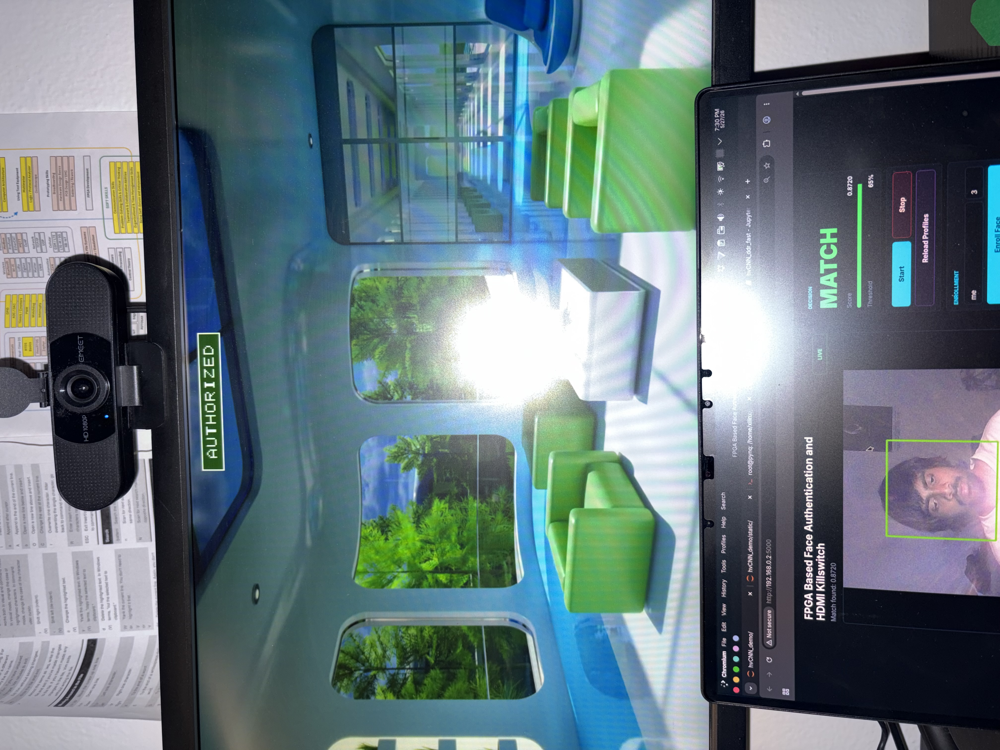
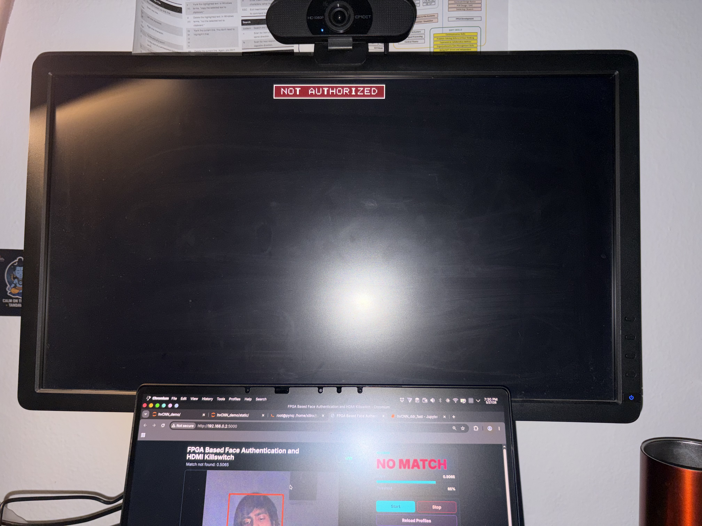
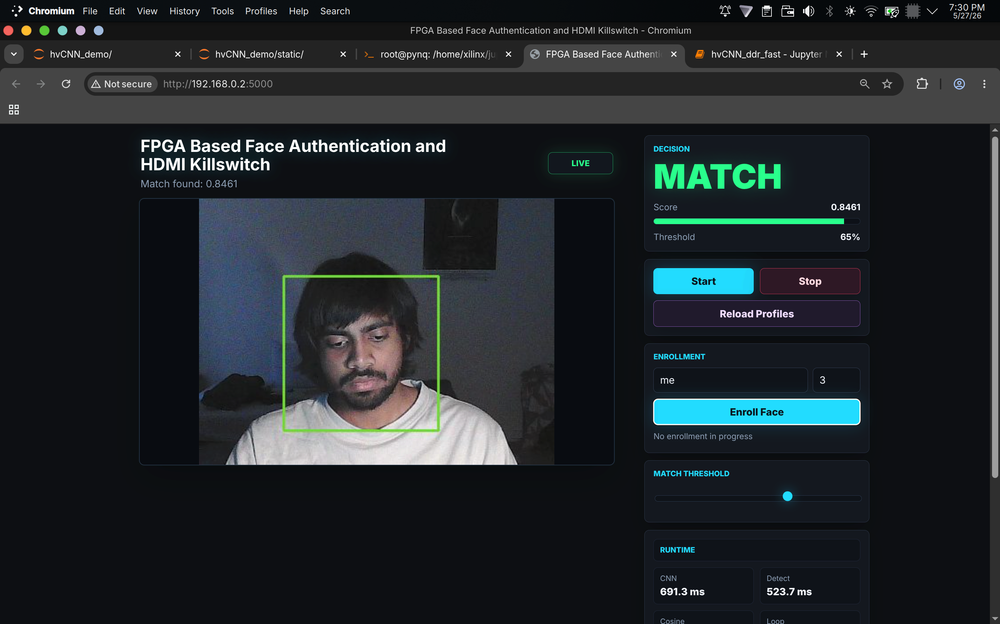

# HDMI Killswitch

An FPGA HDMI kill switch gated by CNN face authentication, on the PYNQ-Z2
(Zynq-7020). The board sits between a PC and a monitor. A face-embedding CNN and
a cosine-similarity IP, both in the fabric, decide whether the HDMI stream passes
through or the monitor goes black. Sync is always forwarded so the monitor stays
locked, and an on-screen banner shows AUTHORIZED / NOT AUTHORIZED.

## Demo

Live on the PYNQ-Z2. The dashboard scores the camera face and the HDMI output is
gated accordingly (match threshold 65%).

| Authorized | Not authorized |
|:---:|:---:|
|  |  |
| Match score 0.87: video passes through, green AUTHORIZED banner | Match score 0.51: screen blacked out, red NOT AUTHORIZED banner |

<p align="center">
  <br>
  <em>Web dashboard: live camera, match decision, score, enrollment and threshold controls</em>
</p>

Demo video: [`media/demo.mp4`](media/demo.mp4)

## How it works

```text
PC --HDMI--> dvi2rgb -> auth gate + overlay -> rgb2dvi --HDMI--> Monitor
                              ^ auth bit
camera -> tinyFaceNet CNN IP -> 128-d embedding -> cosine_sim_axi vs. enrolled -> match
```

- **tinyFaceNet**: 112x112 RGB to 128-d L2-normalized embedding. PyTorch
  (ArcFace-style), BN folded, int16 Q12 weights, Vitis HLS integer-MAC IP.
- **cosine_sim_axi**: AXI cosine-similarity IP, threshold in Q2.30.
- **Auth gate**: auth bit is 2-flop synchronized into the pixel clock domain and
  latched at vsync, so frames never tear.

## Results

| | |
|---|---|
| tinyFaceNet IP | 27,004 LUT, 50 DSP, 10 BRAM_18K; cosine 0.99999 vs. reference |
| HDMI passthrough | 1,561 LUT, 2,560 FF, 1 BRAM; WNS +1.254 ns |
| CNN inference on PYNQ | ~691 ms |
| Cosine match | ~13 ms |
| Scores at 65% threshold | 0.87 authorized, 0.51 rejected |

## Layout

```text
system/        final design (hvCNN_INT): rtl, constraints, block design, bit/hwh/xsa
tinyfacenet/
  model/         PyTorch model, training, ONNX export, HLS weight prep
  hls/           Vitis HLS IP (integer-MAC) and test vectors
  host/          PYNQ Flask demo + cosine_driver.py (MMIO driver)
  weights/       trained weights, ONNX, Q12 HLS weights
  docs/          implementation reports
hdmi/          bring-up stages: testgen, passthrough, auth gate, cosine auth
media/         demo photos, screenshots, video
```

## Run

```bash
# HLS C-sim and IP packaging
cd tinyfacenet/hls
vitis-run --mode hls --tcl run_hls_csim.tcl
vitis-run --mode hls --tcl package_ip_no_csim.tcl

# On the PYNQ-Z2 (load system/hw/hvCNN_INT.bit + .hwh)
cd tinyfacenet/host && pip install -r requirements.txt && python app.py
```

## Software drivers

- `tinyfacenet/host/cosine_driver.py`: `CosineSimilarity` class for the cosine IP
  (CTRL, STATUS, THRESHOLD, vector select/data registers).
- `tinyfacenet/host/app.py`: drives the tinyFaceNet IP over MMIO (control, image,
  weights, scratch, output registers) with `pynq.allocate` buffers.
